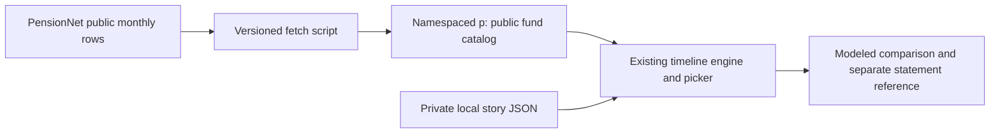

# PensionNet imports in the existing calculator

Target: 2026-11-22. Add the missing public pension return source without changing
product identity or publishing any imported financial statement.

## Scope and boundaries

- Pension keys use `p:<id>`; gemel and insurance keys and behavior stay unchanged.
- Official monthly investment yields do not include personal insurance charges,
  personal management fees or an account's demographic adjustment.
- A local imported story may carry a read-only `context` with a label, notes,
  statement closing balance and a shared end-period adjustment. The reference is
  separate from both modeled results; it never calibrates the model silently.
- The context adjustment changes neither the gross simulation, its chart nor its
  annualized return. A separate summary labels the adjusted estimates and residual.
- A `private: true` story is loaded by the existing file import. Language changes
  cannot serialize it into a URL; export first, change language and reimport.
- Importing a new story clears prior results so a different statement reference cannot remain visible.
- No uploaded images, account identifiers, personal amounts, real-statement test
  fixtures, private story URLs, remote storage or new paid services.
- This does not resolve an unknown comprehensive/general pension identity.
  Conditional context remains explicit. No recommendation to switch investments.

## Acceptance

- Pension fund identity remains namespaced through ingestion, search, MCP and
  official source verification, including overlapping numeric IDs.
- Missing months remain null, not made up; source freshness is visible.
- Synthetic unit and native-browser tests cover both pension scenarios, context
  preservation, safe text rendering and the no-private-URL language guard.
- Existing tests, Chrome/WebKit, exact-head independent review and live mobile
  verification are required before claiming deployment.
